<div align="center">


<br/>

**Sovereign, on-premise agentic AI for enterprise data.**

**A locally-hosted AI workbench where agents answer questions and produce deliverables grounded in *your* documents, with zero data leaving your machine.**

<br/>


[Why](#-why-this-exists) •
[Features](#-features) •
[Architecture](#-architecture) •
[Quick Start](#-quick-start) •
[Demo](#-demo-walkthrough) •
[Hardware](#-hardware-guide) •
[Roadmap](#-roadmap)

</div>

---

## 🎯 Why this exists

Organizations want generative AI and autonomous agents, but **can't send confidential data to public cloud AI APIs.** Meanwhile, employees juggle disconnected tools, answers are often hallucinated, and nobody can prove what the AI did.

**Enclave AI** fixes that:

| The problem | Enclave AI's answer |
|---|---|
| 🔒 Confidential data can't go to the cloud | Models run **on your own hardware** via Ollama |
| 🧩 Many tools, no single interface | **One workbench** for models, documents, agents, and tools |
| 🤥 AI makes things up | **RAG + validation step.** No evidence means "not found in provided documents" |
| 🕵️ No accountability | **Audit log** of every request, source, tool call, and output |
| 🌐 "Is it really offline?" | Verify with **Wireshark / netstat**, or just pull the network cable |

> **Sovereign** = you own the models, data, and governance. **On-Premise** = it runs on your infrastructure. **Agentic** = it plans, picks tools, acts, and verifies, rather than just chatting.

---

## 🎬 How Enclave AI works

<div align="center">
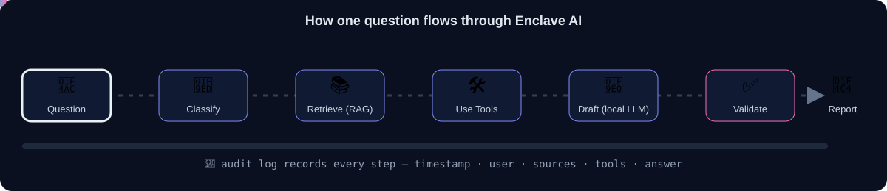
</div>

A plain chatbot generates an answer. This agent **decides how to solve the task**: it classifies the question, retrieves evidence, calls tools when numbers are involved, drafts from that context only, then **checks its own draft against the sources** before you see it.

---

## 📸 Screenshots

A look at the running app. Everything below was captured from a live local instance.

### 🔐 Sign in
<div align="center">
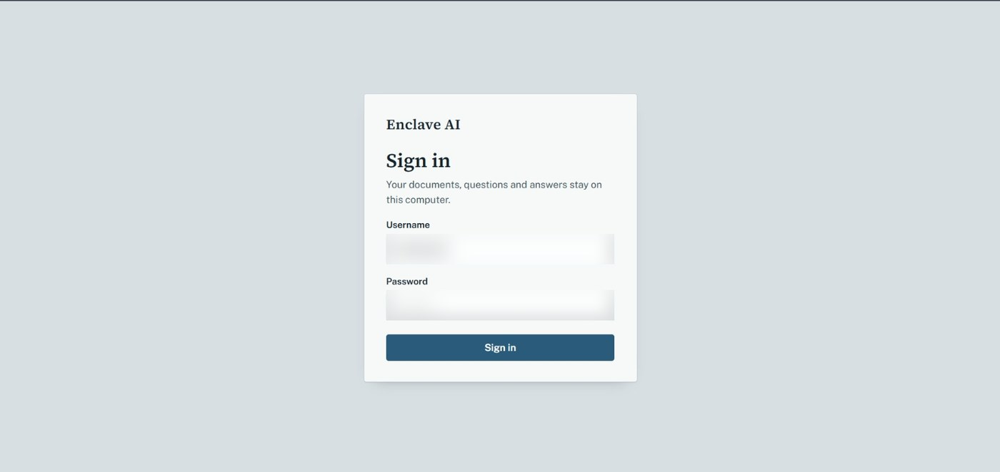
<br/><sub>Login with hashed passwords and JWT sessions. Your documents, questions, and answers stay on this computer.</sub>
</div>

### 💬 Ask your documents
<div align="center">
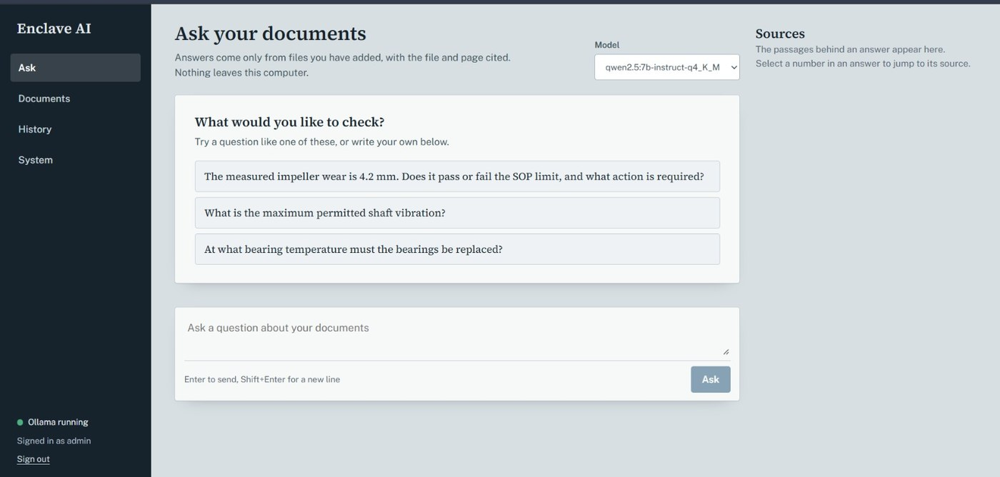
<br/><sub>Suggested starter questions, a model dropdown, and live "Ollama running" status in the sidebar.</sub>
</div>

<table>
<tr>
<td width="50%">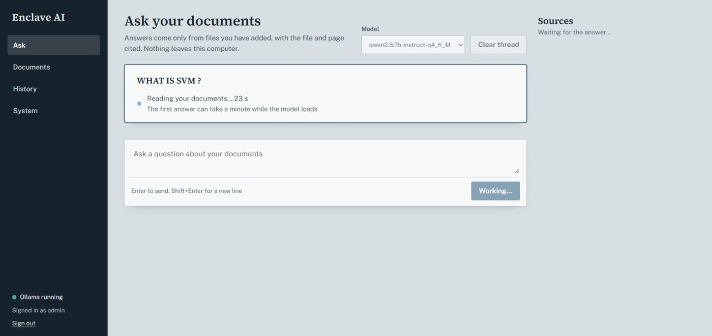<br/><sub><b>1. Agent at work.</b> Live progress while it reads your documents.</sub></td>
<td width="50%">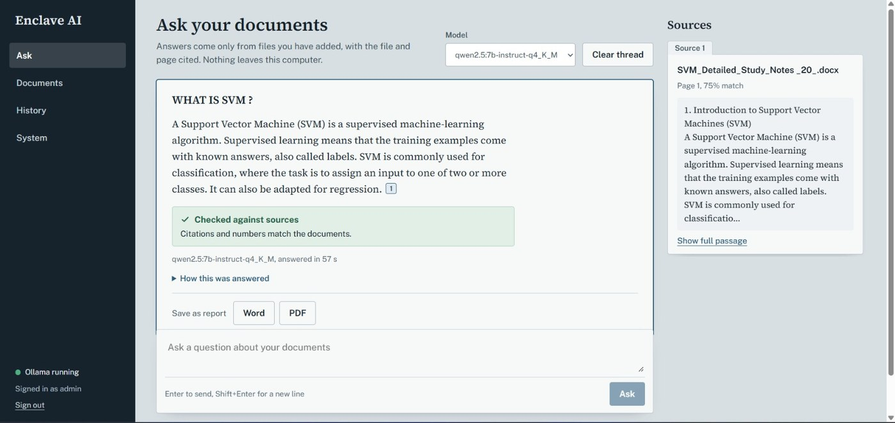<br/><sub><b>2. Cited answer.</b> The green "Checked against sources" badge plus a Sources panel with file, page, and match %.</sub></td>
</tr>
</table>

<div align="center">
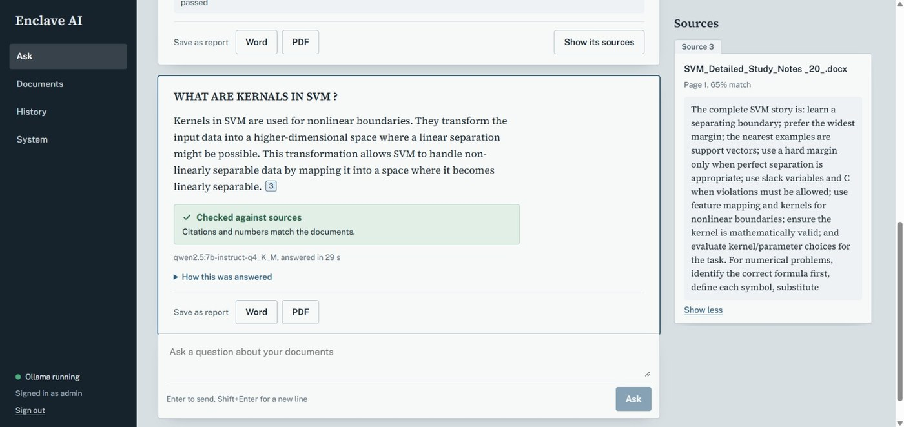
<br/><sub>Follow-up questions in the same thread. Click a citation to expand the full source passage, then save the answer as Word or PDF.</sub>
</div>

### 📄 Documents (knowledge base)
<div align="center">
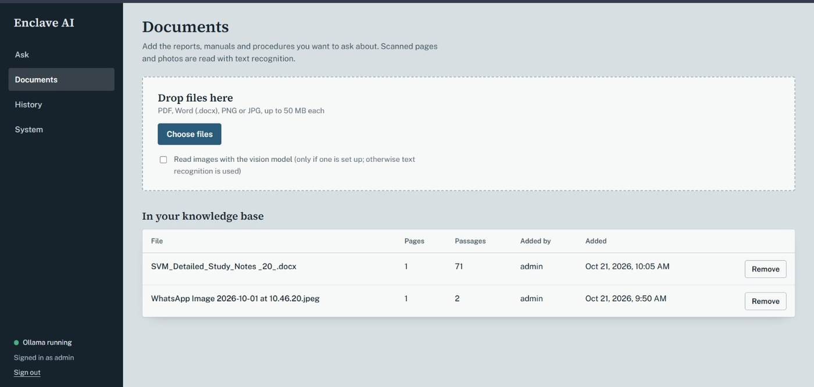
<br/><sub>Drag and drop PDF, DOCX, PNG, or JPG (up to 50 MB). Scanned pages and photos are read with OCR. Every file is tracked with pages, passages, who added it, and when.</sub>
</div>

### 📝 Generated report
<div align="center">
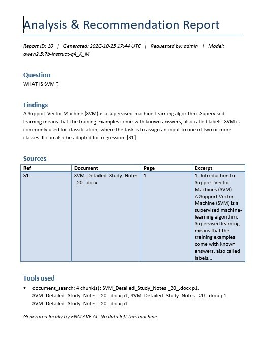
<br/><sub>One click produces an Analysis & Recommendation Report with the question, findings, a source table, and tools used. It is stamped "Generated locally. No data left this machine."</sub>
</div>

### 🕵️ History & audit trail
<div align="center">
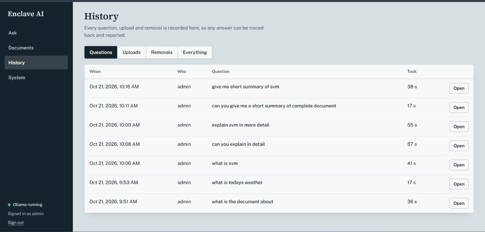
<br/><sub>Every question, upload, and removal is logged with timestamp, user, and response time, so any answer can be traced back.</sub>
</div>

<details>
<summary><b>More screenshots</b> (uploads log, full audit view, login error)</summary>
<br/>

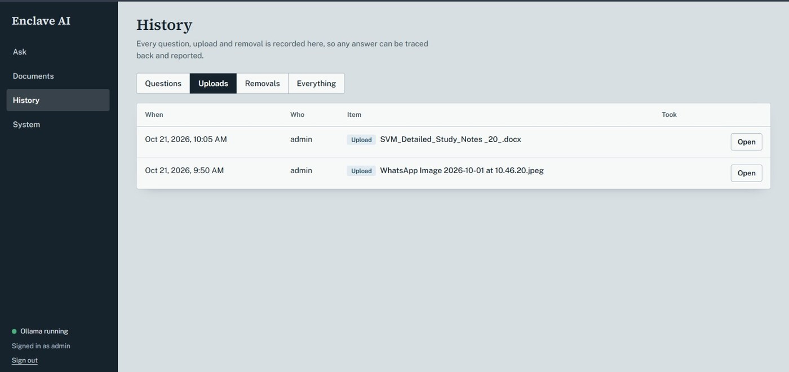
<br/><sub>Uploads tab.</sub>
<br/><br/>
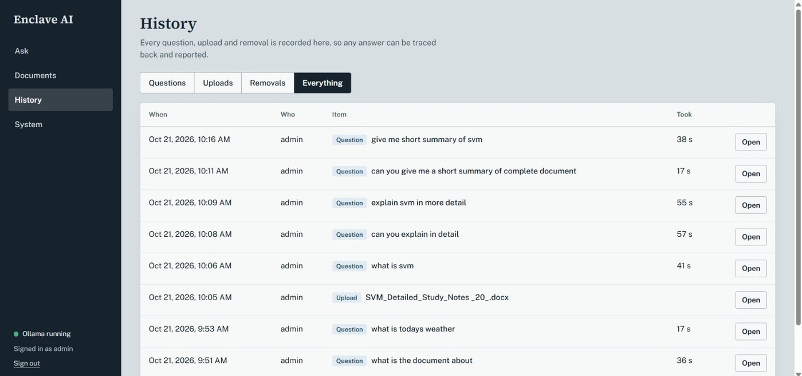
<br/><sub>Everything tab: questions, uploads, and removals in one timeline.</sub>
<br/><br/>
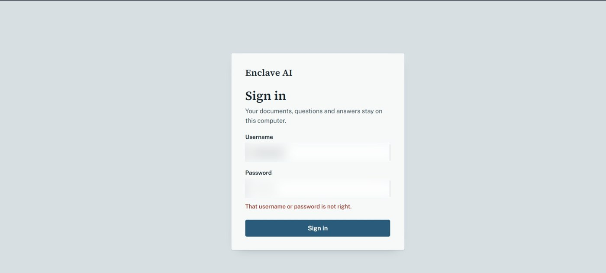
<br/><sub>Failed logins are rejected with a clear error.</sub>

</details>

---

## ✨ Features

| # | Module | What it does | Tech |
|:-:|---|---|---|
| 1 | 🔐 **Login & Access** | Single admin login, bcrypt-hashed, JWT sessions (schema ready for RBAC) | FastAPI · passlib · python-jose |
| 2 | 🧠 **Model Manager** | Runs LLMs locally, with a dropdown to switch models | Ollama · Qwen2.5-7B (Q4) · Llama-3.2-3B / Phi-3.5-mini fallback |
| 3 | 🧭 **Agent Orchestrator** | Classify → retrieve → tool → draft → validate | LangGraph (or a hand-rolled state machine) |
| 4 | 📄 **Document Intelligence** | Ingests PDF, DOCX, and scanned images, with OCR and chunking | Tesseract · pdfplumber · python-docx |
| 5 | 📚 **RAG Knowledge Base** | Top-k semantic search with **file + page citations** | ChromaDB · nomic-embed-text / bge-small |
| 6 | 🛠️ **Tool Layer** | Sandboxed calculator, document search, report writer | numexpr · pandas |
| 7 | 👁️ **Multimodal** | Reads scanned and photographed documents | Tesseract · optional Qwen2-VL-7B |
| 8 | 🛡️ **Security & Governance** | Local-only binding, full audit trail, provable no-egress | SQLite / PostgreSQL · Wireshark |
| 9 | 📝 **Deliverable Generator** | Cited reports as DOCX, PDF, or Markdown | python-docx · reportlab · Pandoc |
| 10 | 🖥️ **Dashboard** | Login, upload, chat, sources view, audit log | React 18 + Next.js 14 (or Vite) |
| 11 | ⚙️ **Backend API** | Glue between UI and AI stack | Python 3.11 · FastAPI · Uvicorn |
| 12 | 📦 **Packaging** | One command boots everything | Docker Compose |

---

## 🏗️ Architecture

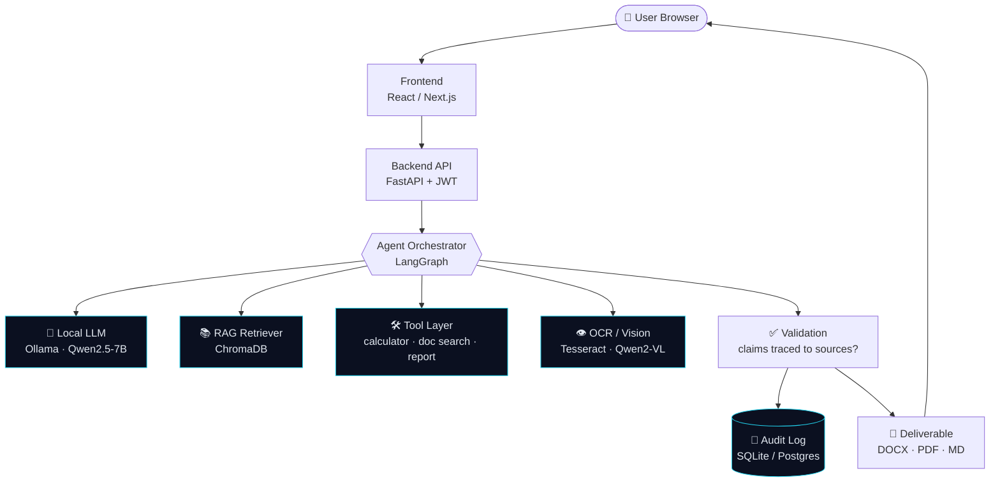

Everything runs as Docker containers on **one machine**, on a local network, with **no external API dependency**.

---

## 🚀 Quick Start

### Prerequisites

- [Docker](https://docs.docker.com/get-docker/) + Docker Compose
- [Ollama](https://ollama.com/download)
- 16 GB RAM (GPU with 8 GB+ VRAM recommended, but CPU-only works with a smaller model)

### 1. Pull the models

```bash
ollama pull qwen2.5:7b-instruct-q4_K_M     # main brain
ollama pull nomic-embed-text               # embeddings

# Weak hardware? Grab a lighter model instead:
ollama pull llama3.2:3b-instruct-q4_K_M
```

### 2. Sanity-check Ollama

```bash
curl http://localhost:11434/api/tags       # should list your models
```

### 3. Launch Enclave AI

```bash
git clone https://github.com/RiyaPandey06/EnclaveAI-Sovereign-On-Premise-Agentic-AI-for-Enterprise-Data.git
cd EnclaveAI-Sovereign-On-Premise-Agentic-AI-for-Enterprise-Data
docker compose up --build
```

### 4. Open it

| Service | URL |
|---|---|
| 🖥️ Enclave UI | http://localhost:3000 |
| ⚙️ API docs (Swagger) | http://localhost:8000/docs |
| ❤️ Health check | http://localhost:8000/health |

### Local dev (without Docker)

```bash
cd backend
python3.11 -m venv venv && source venv/bin/activate   # Windows: venv\Scripts\activate
pip install fastapi uvicorn requests python-multipart pdfplumber python-docx \
            pytesseract pillow chromadb langgraph numexpr pandas passlib[bcrypt] python-jose
uvicorn main:app --reload
```

> 💡 You also need the **Tesseract OCR** binary installed on your system (`apt install tesseract-ocr` / `brew install tesseract`).

---

## 🎥 Demo walkthrough

**Scenario: industrial inspection report analysis**

```text
1. 📤 Upload  → a scanned inspection sheet + 2–3 reference SOP documents
2. 🔍 OCR     → text extracted from the scan, chunked, embedded into ChromaDB
3. 💬 Ask     → "What maintenance action does this report require, based on our SOPs?"
4. 🧭 Agent   → retrieves SOP chunks, reads findings, runs a wear-tolerance calculation
5. ✅ Verify  → draft is checked against retrieved evidence
6. 📄 Output  → one-page maintenance recommendation (DOCX/PDF) with citations
7. 📝 Audit   → query → OCR output → SOP chunks → tool calls → final report
8. 🔌 Proof   → network monitor shows ZERO outbound connections
```

**The mic-drop moment:** unplug the Ethernet / turn off Wi-Fi mid-demo. It still works.

*Prefer something simpler?* The alternative scenario is **HR/policy Q&A** (employee handbook, cited answers, no OCR needed).

---

## 📊 Success metrics

| Goal | Metric | MVP target |
|---|---|---|
| 🔌 Local-only inference | External calls during a full demo | **0** |
| 📚 Grounded Q&A | Answers citing the correct source | **≥ 80%** |
| 🤖 Agentic tool use | Multi-step task with ≥ 2 tools, hands-free | **1 working workflow** |
| 👁️ Multimodal | OCR accuracy on sample scans | **≥ 85%** |
| 📝 Auditability | Requests with a full logged trail | **100%** |
| ⏱️ Latency | Response time on target hardware | **≤ 30 s** |
| 💰 Cost | Total project spend | **≤ $450** |

---

## 🖥️ Hardware guide

| Your machine | Recommended model | Cost |
|---|---|---|
| CPU-only / 4–6 GB VRAM | `llama3.2:3b-instruct-q4_K_M` or `phi3.5:3.8b-mini-instruct-q4_K_M` | **$0** |
| 8 GB VRAM (e.g. RTX 3060/3070) | `qwen2.5:7b-instruct-q4_K_M` ⭐ | **$0** |
| 12–16 GB VRAM | `qwen2.5:14b-instruct-q4_K_M` | **$0** |
| Need vision beyond plain OCR | `qwen2-vl:7b-instruct-q4_K_M` | **$0** |
| Existing hardware too slow | Used RTX 3060 12GB (~$180–230) or RTX 4060 Ti 16GB (~$300–430) | **one-time** |

> ⚠️ **Don't rent cloud GPUs for the live demo.** It defeats the entire sovereign pitch. Cloud is fine for a few hours of pre-demo testing only (~$0.20–0.40/hr).

Storage: 20–50 GB free for models and the vector index.

---

## 🗂️ Project structure

```text
enclave-ai/
├── backend/
│   ├── main.py              # FastAPI entrypoint
│   ├── auth/                # bcrypt + JWT login
│   ├── ingest/              # upload, OCR, chunking
│   ├── rag/                 # embeddings, ChromaDB, retrieval + citations
│   ├── agent/               # LangGraph flow + validation step
│   ├── tools/               # calculator, doc search, report generator
│   ├── audit/               # audit log models
│   └── Dockerfile
├── frontend/                # React / Next.js dashboard
│   └── Dockerfile
├── samples/                 # demo SOPs + scanned inspection sheets
├── assets/                  # README animations
├── docker-compose.yml
└── README.md
```

---

## 🛣️ Roadmap

**Build timeline (6–8 week MVP)**

- [x] **Week 1:** Docker, Ollama + model, FastAPI skeleton
- [ ] **Week 2:** Document ingestion + OCR pipeline
- [ ] **Week 3:** ChromaDB indexing, RAG retrieval, citations
- [ ] **Week 4:** Agent orchestrator + 1–2 tools
- [ ] **Week 5:** Frontend dashboard (upload, chat, sources)
- [ ] **Week 6:** Audit logging + DOCX/PDF generator
- [ ] **Week 7:** Integration tests, offline/no-egress verification, rehearsal
- [ ] **Week 8:** Buffer + mentor demo

**Beyond the MVP**

- [ ] Multi-tenant RBAC, SSO / LDAP
- [ ] Kubernetes / multi-node scaling
- [ ] Fine-tuning custom models
- [ ] Audio / video understanding
- [ ] Compliance work (ISO 27001, SOC 2)

---

## 💰 Cost

| Category | Cost |
|---|---|
| Software (everything is open-source) | **$0** |
| Hardware, if you own a decent PC | **$0** |
| Hardware, if a GPU upgrade is needed | **$180–450** |
| Optional cloud testing | **$0–10** |
| **Total** | **$0 – ~$460** |

---

## 🧯 Risks & mitigations

| Risk | Mitigation |
|---|---|
| Hardware too slow for a live demo | Pre-cache demo queries; use a 3–7B model; keep a CPU fallback |
| Poor OCR on bad scans | Use clean sample documents; note as a roadmap item |
| Ungrounded answers | Strict validation: no supporting chunk means "not found in provided documents" |
| Scope creep | Stick to the MVP list; log the rest as future work |
| "Sovereign" claim not convincing | Disconnect the network live |

---

## 🔍 Verify it's really offline

```bash
# Linux / macOS: watch for any external connections while you use the app
sudo netstat -tunp | grep -v "127.0.0.1"

# Or per-process bandwidth
sudo nethogs
```

Or open **Wireshark**, filter out `127.0.0.1`, run a full query, and watch it stay empty. 🎉

---

## 🤝 Contributing

1. Fork the repo
2. Create a branch: `git checkout -b feature/my-feature`
3. Commit and push
4. Open a Pull Request

Please keep every dependency **free and self-hostable**; that's the project's core promise.

---

<div align="center">

**Built for organizations that can't afford to leak.** 🛡️

*Built by Riya Pandey · If this helped you, drop a ⭐*

</div>
